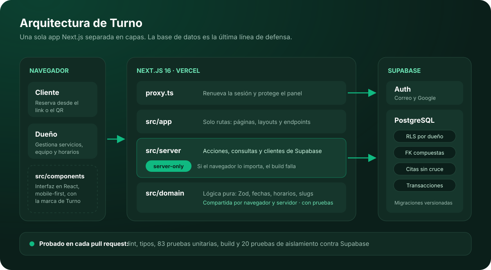

<p align="center">
  <picture>
    <source media="(prefers-color-scheme: dark)" srcset="public/brand/turno-logo-blanco.svg" />
    
  </picture>
</p>

<p align="center">
  <strong>Reservas en línea para pequeños negocios en Perú</strong><br />
  Barberías, clínicas y talleres reciben citas desde su link, su QR o un asistente con IA.
</p>

<p align="center">
  <a href="https://github.com/Clever-RQ/turno/actions/workflows/ci.yml"></a>
  &nbsp;
  <a href="https://turno-eta-seven.vercel.app"><strong>Ver la app en vivo →</strong></a>
</p>

---

## Qué es Turno

Un dueño de barbería en Lima atiende todo el día y no puede contestar el WhatsApp a cada rato. Con Turno, sus clientes reservan solos desde un link o un QR, eligiendo servicio, persona y hora libre. El dueño ve su agenda y sabe qué link o QR le trae más clientes.

**Estado:** en desarrollo. El MVP sale en enero de 2027. Ya están terminados el **Sprint 0** (repositorio, CI, despliegue) y el **Sprint 1** (datos, seguridad y panel del dueño).

<!-- Capturas: agrégalas en docs/screenshots/ y enlázalas aquí. -->

## Lo que ya funciona

**Para el dueño**
- **Cuenta** con correo y contraseña o con Google, con confirmación por correo y recuperación de contraseña. Los correos llevan la marca de Turno.
- **Alta del negocio en dos pasos:** primero el nombre y su link (`turno-eta-seven.vercel.app/barberia-don-lucho`), que se comprueba mientras escribe; luego los servicios, con una vista previa de cómo lo verán sus clientes.
- **Panel:**
  - **Servicios:** duración y precio en soles. Si un servicio ya tiene citas no se borra, se desactiva.
  - **Equipo:** quién atiende. El dueño queda agregado solo.
  - **Horarios:** semana del negocio o de cada persona, turnos partidos (9:00–13:00 y 15:00–20:00) y días libres completos o por horas, en hora de Lima.

**Por debajo**
- Cada negocio está **aislado de los demás** desde la base de datos, y unas pruebas automáticas lo demuestran en cada cambio.

**Lo que viene:** la página pública de reservas y el cálculo de horarios libres (Sprint 2), la agenda y los recordatorios (Sprint 3), el asistente con IA (Sprint 4) y las métricas, los QR y las herramientas WebMCP para agentes del navegador (Sprint 5).

## Arquitectura

<p align="center">
  
</p>

Tres decisiones explican el diseño:

1. **Una sola app, separada en capas.** Next.js junta interfaz y servidor en un mismo proyecto, así que la separación se hace con carpetas dentro de `src/`. Todo lo que toca la base de datos vive en `src/server/` y empieza con `import "server-only"`: si un componente del navegador lo importa por error, **el build falla**. La frontera la revisa el compilador, no la buena voluntad.
2. **La lógica de negocio es pura.** Validaciones, fechas en hora de Lima, horarios, links y teléfonos están en `src/domain/`, sin base de datos ni React. Se prueban rápido y las usan por igual el formulario y el servidor.
3. **La base de datos es la última línea de defensa.** Aunque el código de la app tuviera un error, PostgreSQL sigue haciendo cumplir las reglas de la tabla siguiente.

## Modelo de seguridad

| Regla | Dónde se garantiza |
| --- | --- |
| Un dueño solo ve y edita su negocio | Políticas RLS en cada tabla (`owner_id = auth.uid()`) |
| Un horario o una cita no puede usar personal o servicios de otro negocio | Foreign keys compuestas `(id, negocio_id)` |
| La página pública solo ve datos públicos | Permisos por columna para el rol `anon`: sin `owner_id`, solo servicios y personal activos |
| Una persona no puede tener dos citas que se crucen | Restricción `exclude using gist` en `reservas` |
| Dos turnos del mismo día no se pueden pisar | Restricción `exclude` en `horarios` |
| Una semana se guarda completa o no se guarda | `guardar_horario()` corre en una transacción con los permisos del usuario |
| Las citas y visitas no se escriben desde el navegador | El rol `anon` no tiene permiso de insertar; pasan por la API del servidor |

**Demostrado con pruebas:** `tests/rls/` crea dos dueños reales y temporales y comprueba, contra el proyecto de Supabase, que el dueño A no puede leer, modificar, borrar ni crear nada en el negocio del dueño B, y que un visitante sin cuenta solo lee lo público. Son 20 pruebas y corren en cada pull request.

## Tecnologías

| Capa | Tecnología |
| --- | --- |
| App y API | Next.js 16 (App Router, Server Actions), React 19, TypeScript |
| Estilos | Tailwind CSS 4 |
| Datos y autenticación | Supabase: PostgreSQL, Row Level Security, Auth (correo y Google) |
| Validación | Zod: el mismo esquema en el formulario y en el servidor |
| Pruebas | Vitest: unitarias y de aislamiento de datos |
| CI/CD | GitHub Actions y Vercel |

## Estructura del proyecto

```text
src/
├── app/          solo rutas: páginas, layouts y endpoints
├── components/   interfaz por área: ui, brand, auth, onboarding, panel, services, team, schedules
├── server/       backend (server-only): actions, data, supabase
├── domain/       lógica pura: esquemas Zod, fechas, horarios, slugs, teléfonos
└── proxy.ts      renueva la sesión y protege las rutas privadas
supabase/
├── migrations/   SQL versionado: tablas, RLS, restricciones y funciones
└── templates/    correos de confirmación y recuperación
tests/
├── unit/         rápidas, sin red          → npm run test
└── rls/          aislamiento contra Supabase → npm run test:rls
docs/
├── PLAN.md       plan por sprints y modelo de datos
└── arquitectura.svg
```

## Cómo correrlo

Necesitas Node.js 24, npm y un proyecto de Supabase.

```bash
git clone https://github.com/Clever-RQ/turno.git
cd turno
npm install
cp .env.example .env.local            # completa la URL y las claves de Supabase
npx supabase link --project-ref <tu-project-ref>
npx supabase db push --remote         # aplica las migraciones
npm run dev
```

Abre http://localhost:3000.

En el panel de Supabase, además:
- Agrega `http://localhost:3000/**` en **Authentication → URL Configuration → Redirect URLs**.
- Activa el proveedor **Google** si quieres iniciar sesión con Google.
- Opcional: configura **SMTP** para usar las plantillas de `supabase/templates/`.

## Comandos

| Comando | Qué hace |
| --- | --- |
| `npm run dev` | Servidor de desarrollo |
| `npm run build` | Build de producción |
| `npm run lint` | ESLint |
| `npm run typecheck` | Genera los tipos de rutas y corre `tsc --noEmit` |
| `npm run test` | Pruebas unitarias (sin red) |
| `npm run test:rls` | Pruebas de aislamiento contra tu Supabase (necesita `SUPABASE_SECRET_KEY`) |
| `npm run format` | Prettier |

## Integración continua

En cada pull request y en cada push a `main` corren, en este orden: lint, tipos, pruebas unitarias, build de producción y pruebas de aislamiento. Vercel despliega `main` automáticamente y crea una URL de vista previa para cada pull request.

## Hoja de ruta

| Sprint | Objetivo | Estado |
| --- | --- | --- |
| 0 | Repositorio, CI, Supabase y Vercel | ✅ Terminado |
| 1 | Modelo de datos, RLS, login, alta del negocio, servicios, equipo y horarios | ✅ Terminado |
| 2 | Horarios libres, página pública de reservas, API de reservas y correo de confirmación | ⏳ Siguiente |
| 3 | Agenda del dueño, estados de cita, recordatorios y pruebas de punta a punta | Planificado |
| 4 | Asistente con IA que consulta y reserva | Planificado |
| 5 | Métricas, QR y herramientas WebMCP | Planificado |
| 6 | Negocio piloto, accesibilidad y lanzamiento | Planificado |

---

<p align="center">Hecho por <a href="https://github.com/Clever-RQ">Clever-RQ</a> · Proyecto de portafolio</p>
