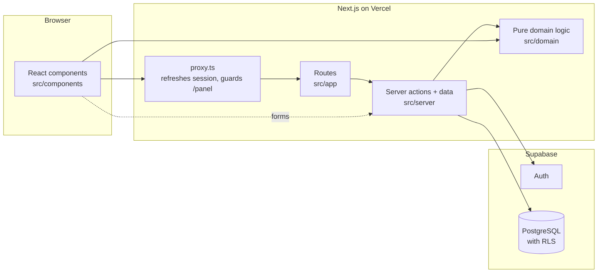

# Turno

**Online booking for small businesses in Peru**: barbershops, clinics, workshops.

Customers book from the business's link or QR code, using a calendar or by chatting with an AI assistant. Owners manage their services, team and schedule, and see which link or QR brings them appointments.

[](https://github.com/Clever-RQ/turno/actions/workflows/ci.yml)
&nbsp;**Live:** https://turno-eta-seven.vercel.app

> Work in progress — MVP planned for January 2027. Sprint 0 (setup) and Sprint 1 (data and owner access) are done.

<!-- Screenshots: add images to docs/screenshots/ and reference them here. -->

## What works today

- **Sign up and sign in** with email and password or Google. Email confirmation and password recovery with branded emails.
- **Onboarding in two steps:** the owner names the business and gets a public link (`turno.app/barberia-don-lucho`), checked for availability while typing; then adds the services customers can book.
- **Owner panel:**
  - **Services** with duration and price in soles; deactivate instead of delete when there are bookings.
  - **Team**: who attends; the owner is added automatically.
  - **Schedules**: weekly hours for the business or per person, split shifts (e.g. 9–13 and 15–20), and days off by full day or by hours, entered in Lima time.
- **Data isolation between businesses**, enforced by the database and proven by automated tests.

Coming next: the public booking page and free-slot calculation (Sprint 2), the owner's agenda and reminders (Sprint 3), the AI assistant (Sprint 4), and visit-to-booking metrics, QR codes and WebMCP tools for browser agents (Sprint 5).

## Stack

| Layer | Technology |
| --- | --- |
| App and API | Next.js 16 (App Router, Server Actions), React 19, TypeScript |
| Styling | Tailwind CSS 4 |
| Database and auth | Supabase: PostgreSQL, Row Level Security, Auth (email + Google) |
| Validation | Zod, the same schemas on the form and on the server |
| Tests | Vitest: unit tests and database isolation tests |
| CI/CD | GitHub Actions and Vercel |

## Architecture



- **One app, clear layers.** `src/server/` holds everything that touches the database. Its modules import `server-only`, so if a browser component imports one, **the build fails**: the frontend/backend boundary is checked by the compiler, not by convention.
- **Pure logic in `src/domain/`.** Validation, Lima ↔ UTC conversion, slugs and phone numbers have no database or React dependencies, so they are easy to test and are shared by the browser and the server.
- **The database is the last line of defense.** Even if application code has a bug, PostgreSQL still enforces the rules below.

## Security model

| Rule | Where it's enforced |
| --- | --- |
| An owner only sees and edits their own business | RLS policies on every table (`owner_id = auth.uid()`) |
| A row can't reference another business's staff or services | Composite foreign keys `(id, negocio_id)` |
| The public booking page sees only public data | Column-level grants for the `anon` role (no `owner_id`, only active services and staff) |
| Two bookings can't overlap for the same staff member | `exclude using gist` constraint on `reservas` |
| Weekly shifts can't overlap | `exclude` constraint on `horarios` |
| A week is saved all-or-nothing | `guardar_horario()` runs in one transaction, as the calling user (RLS still applies) |
| Bookings and visits are never written from the browser | No insert grants for `anon`; they go through the server API |

**Proven by tests:** `tests/rls/` creates two real temporary owners and checks, against the live project, that owner A can't read, update, delete or insert into owner B's data, and that anonymous visitors only read public data. These 20 tests run in CI on every pull request.

## Project structure

```text
src/
  app/            routes only: pages, layouts, route handlers
  components/     UI by area: ui/, brand/, auth/, onboarding/, panel/, services/, team/, schedules/
  server/         backend: actions/, data/, supabase/ (server-only)
  domain/         pure logic: Zod schemas, dates, schedules, slugs, phones
  proxy.ts        session refresh and route protection
supabase/
  migrations/     versioned SQL (tables, RLS, constraints, functions)
  templates/      auth email templates
tests/
  unit/           fast, offline (npm run test)
  rls/            data isolation against Supabase (npm run test:rls)
docs/PLAN.md      sprint plan and data model (Spanish)
```

## Getting started

Requirements: Node.js 24, npm and a Supabase project.

```bash
git clone https://github.com/Clever-RQ/turno.git
cd turno
npm install
cp .env.example .env.local     # fill in your Supabase URL and keys
npx supabase link --project-ref <your-project-ref>
npx supabase db push --remote  # apply the migrations
npm run dev
```

Open http://localhost:3000.

In the Supabase dashboard you also need to: add `http://localhost:3000/**` to the auth redirect URLs, enable the Google provider if you want Google sign-in, and (optionally) configure SMTP to use the templates in `supabase/templates/`.

## Scripts

| Command | What it does |
| --- | --- |
| `npm run dev` | Start the dev server |
| `npm run build` | Production build |
| `npm run lint` | ESLint |
| `npm run typecheck` | Generate route types and run `tsc --noEmit` |
| `npm run test` | Unit tests (offline) |
| `npm run test:rls` | Data isolation tests against your Supabase project (needs `SUPABASE_SECRET_KEY`) |
| `npm run format` | Prettier |

## CI

Every pull request and push to `main` runs lint → typecheck → unit tests → production build → RLS isolation tests. Vercel deploys `main` automatically, and every pull request gets a preview URL.

## Roadmap

| Sprint | Goal | Status |
| --- | --- | --- |
| 0 | Repo, CI, Supabase, Vercel | Done |
| 1 | Data model, RLS, login, onboarding, services, team, schedules | Done |
| 2 | Free-slot calculation, public booking page, booking API, confirmation email | Next |
| 3 | Owner agenda, booking states, reminders, end-to-end tests | Planned |
| 4 | AI assistant with tool calling | Planned |
| 5 | Metrics, QR codes, WebMCP tools | Planned |
| 6 | Pilot business, accessibility, launch | Planned |
